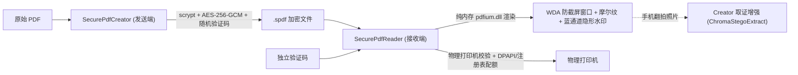

# SecurePdfSuite — 安全架构与标注版源码文档

**SecurePdfSuite** 是一套面向 Windows 10/11（x64 / .NET Framework 4.8）的离线安全 PDF 加密分发与受控阅读套件。发送端与接收端分离打包，压缩包及安装释放后体积均严格控制在 **100 MB** 以内，接收方免安装额外运行库。

> [!IMPORTANT]
> 本仓库文档以 **GitHub-Flavored Markdown** 组织，将全量源码按功能域拆分并附带关键设计标注，方便直接在 GitHub 网页端阅读、代码审计与分享。

## 核心特性与隐私声明

- **一文一码加密容器（`.spdf`）**：使用 `AES-256-GCM` + `scrypt` 密钥派生封装原 PDF，批量处理时每份文件自动生成独立验证码。
- **纯内存解密渲染**：通过 `pdfium.dll` 在内存中逐页渲染，全程不向磁盘释放明文 `.pdf`。
- **小时级有效期与打印次数控制**：发送端可设置允许打印次数（`0` = 禁打）和**按小时计算的有效期**（支持小数小时），接收端本地采用 DPAPI + 注册表双校验配额与系统时间回拨检测。
- **虚拟打印机硬拦截**：通过 `EnumPrinters` 端口/驱动/监控器规则与 GDI `GetDeviceCaps` 检查屏蔽 PDF/XPS/Fax 等虚拟打印机，仅允许输出到物理打印机。
- **防截屏与防翻拍水印**：启用 `SetWindowDisplayAffinity` 防系统截图/录屏及失焦遮蔽；叠加动态摩尔纹与**低饱和蓝通道微偏移加粗隐形水印**（时间 / 局域网 IP / 设备指纹），并内置 `O(W×H)` 局部背景减除取证工具。
- **隐私边界**：全流程**纯本地离线运行**，无联网上报或遥测采集；局域网 IP 与设备指纹仅实时绘制于防外泄水印上用于事后溯源。

## 安装包体积规格

| 安装程序 | 角色 | 安装包体积 | 解压占用 | 依赖环境 |
| :--- | :--- | :---: | :---: | :--- |
| `install_creator.exe` | 发送端（加密 + 取证） | 4.43 MB | 6.62 MB | Windows 10/11 (.NET Framework 4.8) |
| `install_reader.exe` | 接收端（阅读 + 安全打印） | 10.98 MB | 21.71 MB | Windows 10/11 (.NET Framework 4.8) |

## 总体架构

## 标注版源码导航

| 模块文档 | 涵盖内容 | 关键职责 |
| :--- | :--- | :--- |
| [01 — 核心加密、格式与防篡改配额](docs/01-core-crypto-and-quota.md) | `Directory.Build.props`, `SecurePdf.Core.csproj`, `CodeAndCryptoService`, `SpdfContainer`, `DeviceAndNetworkContext`, `LocalQuotaStore` | 验证码生成、scrypt/AES-GCM 加解密、`.spdf` 二进制格式、设备指纹与 IP 采集、DPAPI + 注册表双配额存储及时间回拨检测 |
| [02 — 内存渲染、打印守卫与取证增强](docs/02-core-pdf-printing-forensics.md) | `MemoryPdfRenderer`, `PrinterSecurityGuard`, `WatermarkEnhancer` | 纯内存 PDFium 封装、物理打印机白名单与 GDI 过滤、基于二维积分图的 `ChromaStegoExtract` 隐形水印提取 |
| [03 — 发送端（创建与取证界面）](docs/03-creator-app.md) | `SecurePdf.Creator.csproj`, `App.xaml(.cs)`, `MainWindow.xaml(.cs)` | 批量加密生成 `.spdf` 与验证码、按小时有效期配置（支持小数）、CSV 导出与取证增强交互面板 |
| [04 — 阅读端（防截屏、摩尔纹与安全打印）](docs/04-reader-app.md) | `SecurePdf.Reader.csproj`, `App.xaml(.cs)`, `WindowCaptureProtector`, `AntiCameraOverlay`, `UnlockWindow`, `ReaderWindow`, `SecurePrintDialog` | 验证码解锁、失焦隐私幕布、`SetWindowDisplayAffinity` 防截屏、动态摩尔纹+蓝通道隐形水印、物理打印流程 |
| [05 — 分离式安装器与单元测试](docs/05-installer-and-tests.md) | `SecurePdf.Installer/Program.cs`, `tests/SecurePdf.Core.Tests/*` | C# 5 编写的单文件 ZIP 自解压安装器（支持 `--silent` 与桌面快捷方式）以及 15 项核心单元测试 |
