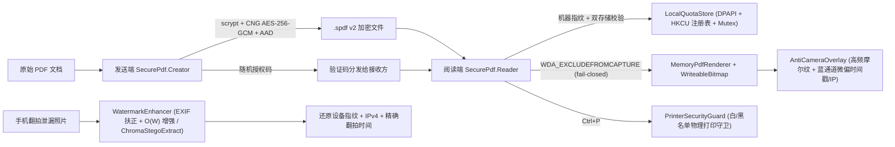

# SecurePdfSuite

面向 Windows 10/11 x64（.NET Framework 4.8）的轻量级本地安全 PDF 分发、受控阅读、防截屏防翻拍、物理打印次数控制与隐形水印取证套件。

> [!IMPORTANT]
> 本仓库在 `docs/` 目录中提供**全量源码级归档与构建说明**（含项目配置、核心库、发送端、阅读端、自解压安装器及 60 项 xUnit 单元测试），核心目标是在无第三方运行期加密/压缩依赖的前提下实现可控本地阅读、防翻拍取证与高压缩单文件分发。

---

## v1.1.0 核心升级亮点

- **零第三方运行期加密依赖，安装包体积大幅压缩**：
  - 移除 `BouncyCastle.Cryptography.dll`（原 `6.87 MB`），改为纯托管 RFC 7914 `scrypt`（含成本上限护栏 `<= 128 MiB`）+ Windows 原生 CNG (`bcrypt.dll`) AES-256-GCM，与 v1.0.x `.spdf` 文件**字节级兼容**。
  - 移除 `PdfiumViewer` 及其携带 V8/XFA 引擎的巨型原生库，改为直接 P/Invoke 无 V8/XFA 精简版 `pdfium.dll`（`159.0.8152`，`7.47 MiB`），随附 `THIRD-PARTY-NOTICES.txt`。
  - 安装器改用 Windows 原生 `cabinet.dll` LZMS（16 MB 分块 + SHA-256 校验）：**发送端安装包仅 `71.0 KB`（`72,704 B`，解包约 `0.10 MB`），阅读端安装包仅 `2.88 MB`（`3,024,384 B`，解包约 `7.58 MB`）**。
- **渲染、打印与取证稳定性重构**：
  - `PrinterSecurityGuard`：端口白名单与黑名单双重校验（拦截 PDF/XPS/OneNote/传真/`PORTPROMPT:`/`FILE:`/`NUL:`/`KeepPrintedJobs`/未认证 Local Monitor 端口及回环/本机共享打印机），修复高 DPI 下 `GraphicsUnit.Pixel` 600 DPI 缩放错误，支持零页发送回滚配额 (`SecurePrintException`)。
  - `MemoryPdfRenderer` & `ReaderWindow`：全局 `PdfiumLock`、屏幕渲染禁用 LCD 次像素抗锯齿、基于 `WriteableBitmap` 与 `OnDpiChanged` 的 DPI 感知内存渲染（`ScreenPixelBudget = 32M`）、文本编辑快捷键豁免与 30 秒周期性有效期/时钟/IP 巡检。
  - `WatermarkEnhancer`：将旧版 `O(W×H)` 二维积分图替换为 `O(W)` 滚动环形均值窗口，大幅降低大图取证内存峰值，并支持 EXIF `0x0112` 自动扶正与 `50M` 像素限制。
- **安装、升级与交互安全**：
  - 截屏保护（`WDA_EXCLUDEFROMCAPTURE`）不可用或运行时失效立即 `fail-closed` 退出；发送端增加非覆盖 `_1/_2` 命名、CSV 公式注入中和、未保存验证码关窗提醒及 Vista+ `IFileOpenDialog` 目录选择；安装器自动清除旧版 `BouncyCastle.Cryptography.dll` 并生成按明示文件清单清理、非递归移除空目录的安全卸载脚本。

---

## 系统架构流

---

## 文档与源码模块导航

> [!TIP]
> 每个专题文档末尾均提供完整源码；[`05-installer-and-tests.md`](./docs/05-installer-and-tests.md) 额外收录了 `nuget.config` 与完整的 MSBuild / `dotnet test` / `csc.exe` 打包步骤，仅凭 `docs/` 即可完整复现构建。

| 文档章节 | 覆盖模块与核心内容 | 链接 |
| :--- | :--- | :--- |
| **01 核心加密与防篡改配额** | `Directory.Build.props`、`SecurePdf.Core.csproj`、RFC 7914 `scrypt` + CNG AES-256-GCM、`.spdf` v2 容器封装、机器指纹与 IP 采集、DPAPI+注册表双存储与互斥锁状态机 | [`01-core-crypto-and-quota.md`](./docs/01-core-crypto-and-quota.md) |
| **02 PDF 渲染、打印守卫与取证** | 原生 `pdfium.dll` 纯内存光栅化、物理打印白/黑名单与高 DPI 修复、`O(W)` 滚动背景减除 + `ChromaStegoExtract` 取证算法 | [`02-core-pdf-printing-forensics.md`](./docs/02-core-pdf-printing-forensics.md) |
| **03 发送端应用 (`Creator`)** | WPF 界面、Vista+ 现代目录选择、批量加密与非覆盖重命名、CSV 公式注入中和、未保存验证码提醒、翻拍取证工作台 | [`03-creator-app.md`](./docs/03-creator-app.md) |
| **04 接收端阅读器 (`Reader`)** | 双击 `.spdf` 入口、`WDA_EXCLUDEFROMCAPTURE` `fail-closed` 防护、动态摩尔纹与微点水印、DPI 感知无盘渲染、30 秒周期巡检与安全物理打印弹窗 | [`04-reader-app.md`](./docs/04-reader-app.md) |
| **05 安装器、构建指南与单元测试** | `nuget.config`、Release 构建与 LZMS 打包步骤、C# 5 双模式安装器 `Program.cs`、`THIRD-PARTY-NOTICES.txt`、`.bat` 关联脚本与 60 项 xUnit 测试源码 | [`05-installer-and-tests.md`](./docs/05-installer-and-tests.md) |

---

## 单元测试与运行环境说明

- **运行环境**：Windows 10 / 11 x64（`.NET Framework 4.8`，桌面交互环境）。
- **测试覆盖**：`tests/SecurePdf.Core.Tests` 在 `Release | net48` 下共计 **60 项 xUnit 测试全部通过**（密码与设备上下文、`.spdf` 容器加解密/篡改/截断/`scrypt` 成本边界、`LocalQuotaStore` 双存储恢复/时钟回拨/过期、`PrinterSecurityGuard` 物理/虚拟打印机与页面 DPI 计算、`WatermarkEnhancer` 干扰信噪比与像素阈值）。
- **安全边界提示**：本套件在 Windows 用户态提供纵深防御，无法对抗内核驱动级硬件拦截、外部物理相机拍摄，且本地配额与时钟策略默认运行在未拥有本机管理员完全破坏权/时间控制权的常规办公环境中；请勿将纯本地机制视为不可突破的硬件 DRM。

---

*本文档集按实际源码与发布产物生成，归档版本 `v1.1.0`。*
